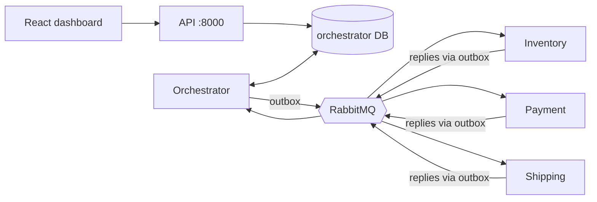

# SagaFlow — Distributed Transaction & Saga Orchestration Platform

An e-commerce order workflow (create order → reserve inventory → authorize payment → arrange shipping) coordinated by a **saga orchestrator** across independently-owned services, with a transactional outbox, idempotent consumers, compensating transactions, retries with backoff, dead-letter queues, crash recovery, fault injection, metrics and an admin dashboard.

> **Status honesty:** the saga core is tested (46 passing tests on SQLite + an in-memory broker). The PostgreSQL/RabbitMQ adapters, FastAPI layer, React dashboard, Docker Compose stack, Prometheus/Grafana config and CI are **written but were not executed** in the build sandbox (no Docker/network). See [BUILD_STATUS.md](BUILD_STATUS.md).

## Problem
Each service owns its database, so there is no single `COMMIT` across them. Messages get lost, delayed and duplicated, and processes crash mid-workflow. SagaFlow shows how to still reach a correct, *eventually consistent* outcome. See [docs/concepts.md](docs/concepts.md).

## Key features
Saga state machine with validated transitions and persisted history · optimistic locking (`version`) · transactional outbox + relay · idempotent consumers (`processed_messages`) · reverse-order compensation · bounded retries with exponential backoff · DLQs for poison messages · stale-saga/startup recovery · explicit `UNKNOWN` outcomes · concurrency-safe stock reservation · dev-only failure injection · Prometheus metrics + Grafana dashboard · structured JSON logs.

## Architecture

Details: [architecture](docs/architecture.md) · [saga lifecycle](docs/saga-lifecycle.md) · [failure recovery](docs/failure-recovery.md) · [database](docs/database-design.md) · [API](docs/api-reference.md) · [testing](docs/testing.md) · [benchmarking](docs/benchmarking.md) · [security](docs/security.md) · [ADRs](docs/adr/).

## Stack
Python, FastAPI, Pydantic, PostgreSQL (psycopg 3), RabbitMQ (pika), React + TypeScript + Vite + Recharts, Docker Compose, Prometheus, Grafana, GitHub Actions, Ruff.
**Deviations from the original brief (documented):** a thin DB-API layer + plain SQL migrations instead of SQLAlchemy/Alembic; `pika` instead of `aio-pika`; `unittest`-style tests that also run under pytest; a small built-in Prometheus text exporter instead of `prometheus_client`. Reason: the build environment had no network access, and these choices let the core be executed and tested there.

## Quick start (Docker)
```sh
cp .env.example .env
docker compose up --build -d          # services run their own migrations on startup
sh scripts/seed.sh                    # dev seed: docker compose exec inventory python -m seed
python scripts/smoke.py               # happy path + shipping-failure compensation
```
Windows PowerShell: `./scripts/windows-quickstart.ps1` (or run the same commands manually; use `Copy-Item .env.example .env`).

| What | URL |
|---|---|
| Dashboard | http://localhost:3000 |
| API docs (OpenAPI) | http://localhost:8000/docs |
| RabbitMQ management | http://localhost:15672 (credentials from `.env`) |
| Prometheus / Grafana | http://localhost:9090 / http://localhost:3001 (`admin` / `GRAFANA_ADMIN_PASSWORD`) |

## Sample workflow
```sh
curl -X POST localhost:8000/api/v1/orders -H "Idempotency-Key: demo-0001" -H "Content-Type: application/json" \
  -d '{"customer_ref":"alice","items":[{"sku":"WIDGET","quantity":2,"unit_price_cents":1000}]}'
curl localhost:8000/api/v1/sagas/<saga_id>/history
```

## Example failure scenario & compensation walkthrough
Add `"simulate":{"shipping_fail":true}` to the order (dev mode). Timeline in `/history`:
`SAGA_STARTED → STEP_COMPLETED(RESERVE_INVENTORY) → STEP_COMPLETED(PROCESS_PAYMENT) → STEP_FAILED(ARRANGE_SHIPPING) → COMPENSATION_STARTED → COMPENSATION_DISPATCHED(PROCESS_PAYMENT) → COMPENSATION_COMPLETED → COMPENSATION_DISPATCHED(RESERVE_INVENTORY) → COMPENSATION_COMPLETED → SAGA_COMPENSATED`. Payment ends `VOIDED`, stock is restored, order `CANCELLED`. Add `"compensation_fail":["payment_void"]` and the saga stops in `REQUIRES_ATTENTION` (never `COMPENSATED`); `POST /sagas/{id}/retry` resumes. This exact behaviour is asserted in `backend/tests/test_e2e.py`.

## Tests
`sh scripts/run_tests.sh all` (or `python -m pytest`). Categories: `unit | db | messaging | e2e | api`. See [docs/testing.md](docs/testing.md) for what is and isn't covered.

## Benchmarks
`make bench` (core, no Docker) or Locust against the stack — [docs/benchmarking.md](docs/benchmarking.md). No numbers are claimed beyond `benchmarks/results/bench_core_sandbox.txt`.

## Observability
`/metrics` on every service; Grafana dashboard "SagaFlow" is auto-provisioned. Metrics include saga started/completed/failures, compensation attempts/failures, retries, message failures/DLQ, duplicates ignored, workflow duration, HTTP count/latency (route-template labels only — no ids). Queue backlog is shown in the dashboard Overview (from the broker), not as a Prometheus metric.

## Troubleshooting
- Services restart repeatedly → `docker compose logs <svc>`; usually Postgres/RabbitMQ still starting.
- `postgres-init.sql` only runs on first start; after changing it: `docker compose down -v`.
- Order stays `RUNNING` → check Dead-Letter page / `GET /sagas/{id}` (`pending_outbox`), then `POST /sagas/{id}/recover`.
- Dev scenarios ignored → `ENABLE_DEV_ENDPOINTS=true` and `SAGAFLOW_ENV=development` required.

## Known limitations
Untested against real PostgreSQL/RabbitMQ in this repo's recorded run · poll-based consumers · one shared DB user · no auth beyond a shared admin token · orders co-located with orchestrator · queue backlog not a Prometheus metric · no automated timeout-to-compensation after a service is down longer than the retry budget · frontend not type-checked/built here. Security limits: [docs/security.md](docs/security.md).

## Future improvements
`SKIP LOCKED` multi-relay · push consumers with prefetch · keyset pagination · `timestamptz` columns · real auth · Testcontainers CI job for PostgreSQL/RabbitMQ · alerting rules.
