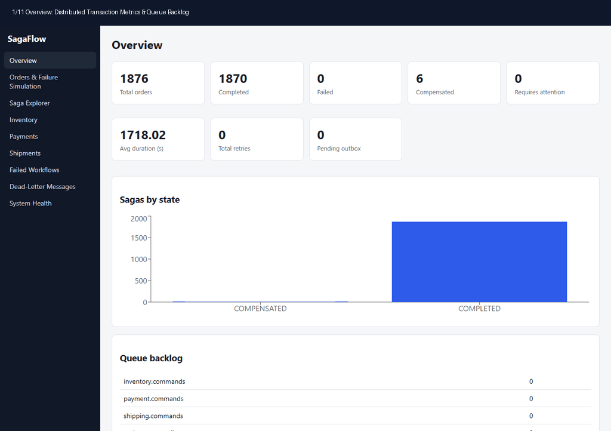
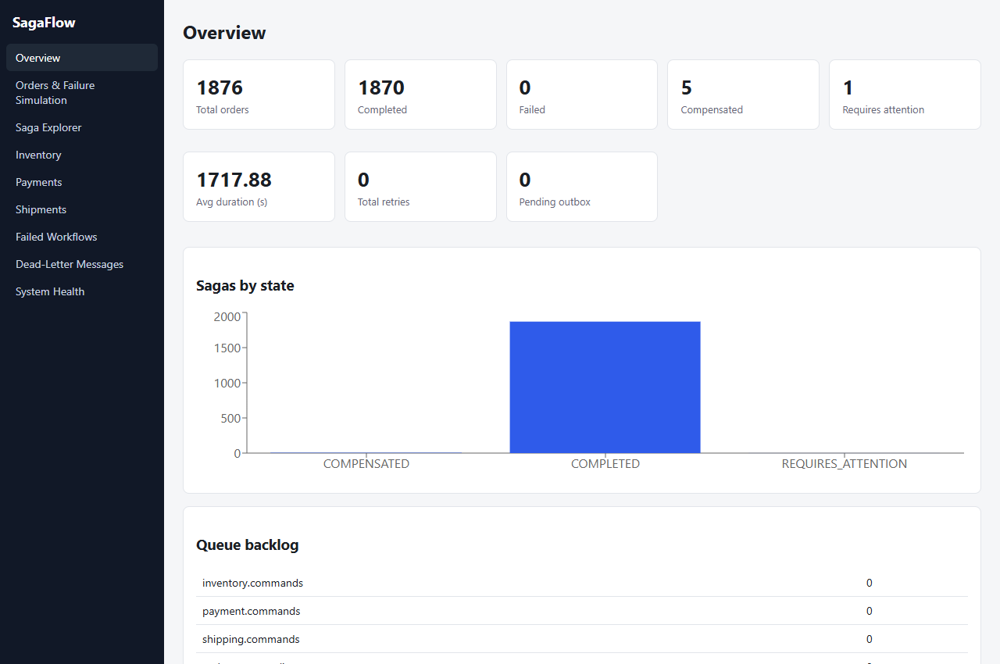
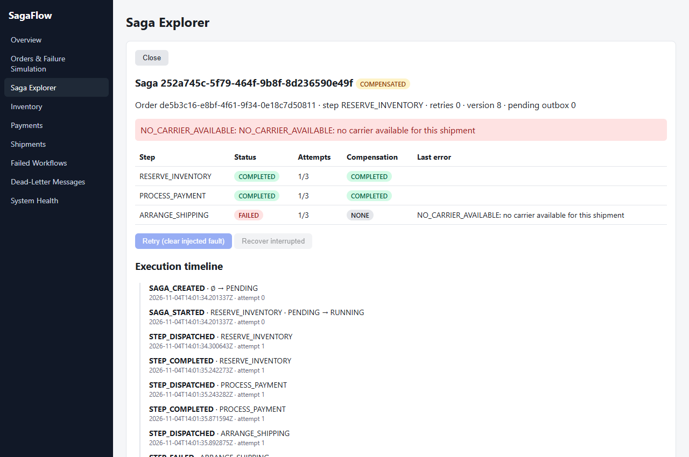
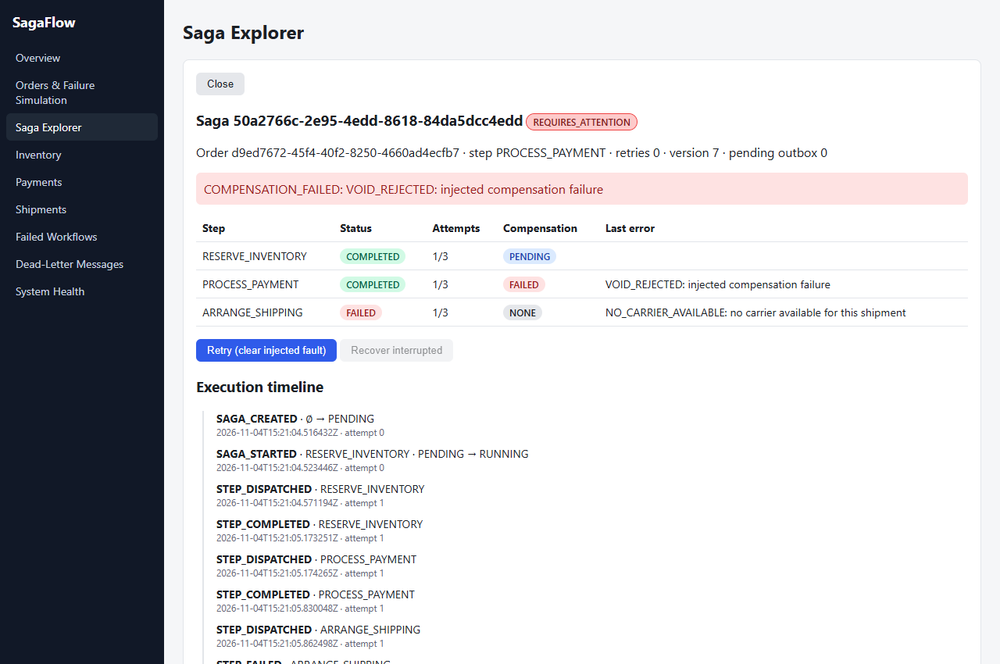
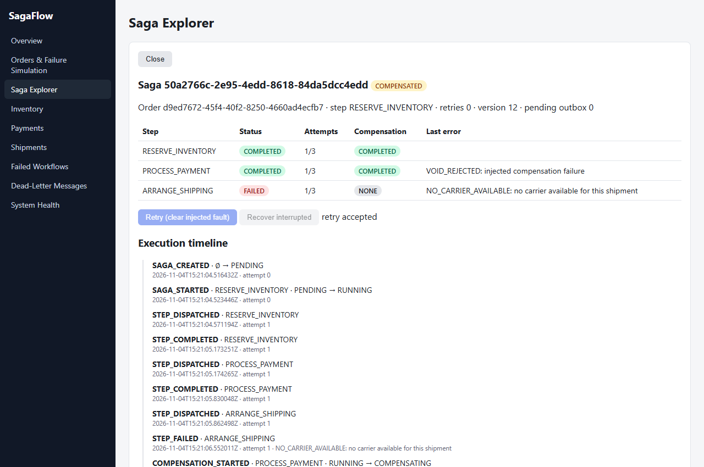
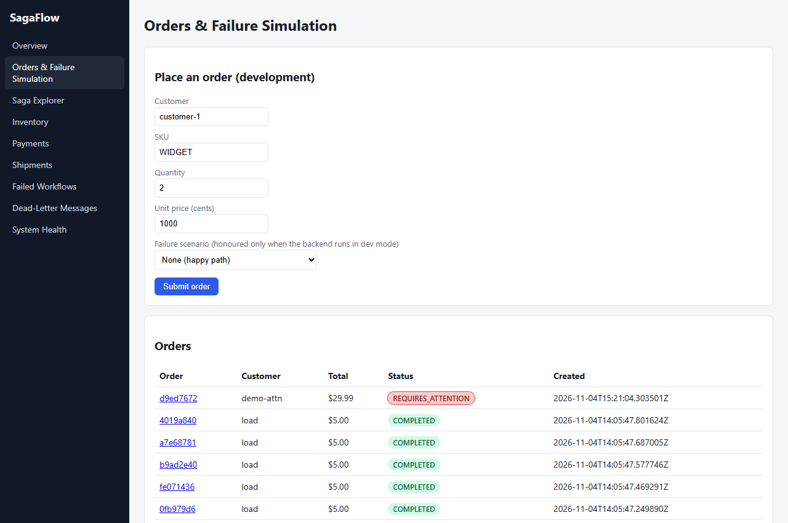
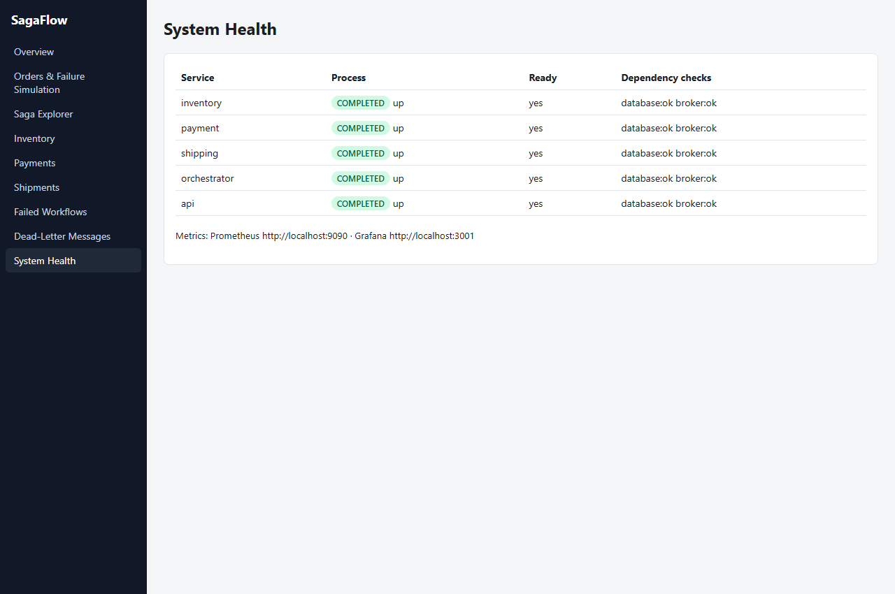

# SagaFlow — Distributed Transaction & Saga Orchestration Platform

[](https://github.com/Ayyappanmj/SagaFlow/actions/workflows/ci.yml)


-brightgreen)


An e-commerce order workflow (`Create Order` → `Reserve Inventory` → `Authorize Payment` → `Arrange Shipping`) coordinated by an **orchestrated saga engine** across independently-owned microservices. SagaFlow features a transactional outbox, idempotent consumers, reverse-order compensation, bounded retries with exponential backoff, dead-letter queues, crash recovery, fault injection, Prometheus metrics, and a real-time operator dashboard.



---

## ⚡ Try It in 5 Minutes

You can run SagaFlow either **locally without Docker** (lightweight, zero external dependencies) or using **Docker Compose** (full PostgreSQL, RabbitMQ, Prometheus & Grafana stack).

### Option A: Local Run (No Docker Required)
Requires Python 3.11+ and Node.js 18+.

```bash
# 1. Clone and set up backend virtual environment
python -m venv .venv
# Windows: .\.venv\Scripts\activate | Linux/macOS: source .venv/bin/activate
pip install -r backend/requirements-dev.txt

# 2. Configure environment (uses SQLite + built-in inter-process broker)
cp .env.example .env

# 3. Seed initial inventory & start all 5 microservices
python -m seed
python scripts/run_local.py
```

In a separate terminal, launch the dashboard:
```bash
# 4. Start React operator dashboard
cd frontend
npm install
npm run dev
```

Run the automated smoke test:
```bash
python scripts/smoke.py
# Output:
# happy path: saga cb0c3d8f-80a8-4717-bb3c-135df22ad547 -> COMPLETED
# shipping failure -> compensation: saga 252a745c-5f79-464f-9b8f-8d236590e49f -> COMPENSATED
```

### Option B: Docker Compose
```bash
cp .env.example .env
docker compose up --build -d
sh scripts/seed.sh
python scripts/smoke.py
```

### Service Map & URLs

| Service / Tool | Local (No Docker) | Docker Compose | Notes |
|---|---|---|---|
| **Operator Dashboard** | [http://localhost:3000](http://localhost:3000) | [http://localhost:3000](http://localhost:3000) | React + Vite + Recharts |
| **API Gateway & Docs** | [http://localhost:8000/docs](http://localhost:8000/docs) | [http://localhost:8000/docs](http://localhost:8000/docs) | Interactive Swagger / OpenAPI |
| **Orchestrator Internal** | `http://localhost:8010` | Internal container | Coordinates saga state machine |
| **Inventory Service** | `http://localhost:8001` | Internal container | Stock reservations with row locks |
| **Payment Service** | `http://localhost:8002` | Internal container | Authorizations & voids |
| **Shipping Service** | `http://localhost:8003` | Internal container | Consignments & carrier dispatch |
| **RabbitMQ Management** | Built-in SQLite Broker | [http://localhost:15672](http://localhost:15672) | Default: `guest` / `guest` |
| **Prometheus / Grafana** | Built-in `/metrics` | [http://localhost:3001](http://localhost:3001) | Default: `admin` / `admin` |

---

## 📸 System Screenshots

### 1. Operations Overview & Queue Backlog
Real-time metrics, saga status breakdown, duration averages, and queue depth.


### 2. Saga Timeline & Reverse Compensation
Complete visual audit log of a failed shipping step triggering reverse-order compensation (payment voided first, then inventory unreserved).


### 3. Quarantine & Safe Operator Recovery
When a compensating step encounters a downstream failure, SagaFlow quarantines the saga into `REQUIRES_ATTENTION` rather than corrupting state. Operators can inspect and trigger targeted retry with fault clearing.
| Before Retry (Stuck in Quarantine) | After Operator Retry (Recovered) |
|---|---|
|  |  |

### 4. Interactive Simulation & Failure Testing
Dev console supporting interactive fault injection (payment decline, shipping failure, inventory rejection, transient timeouts, lost replies, compensation failures).


### 5. System Health & Microservice Readiness
Continuous live readiness and dependency health checks across all microservices.


---

## 🛡️ Guarantees and Non-Guarantees

| Category | Guarantee | Non-Guarantee |
|---|---|---|
| **Atomicity** | **Guaranteed within service boundaries.** Local state changes and outgoing messages commit in the exact same local ACID transaction via Transactional Outbox. | **No distributed atomic commit (2PC).** Services do not lock foreign tables; intermediate states are visible across services until the workflow reaches a terminal state. |
| **Message Delivery** | **At-least-once delivery.** Outbox relay polls or pushes with publisher confirms to RabbitMQ/Broker. Messages survive process restarts. | **No exactly-once transport.** Network partitions or relay crashes between broker ACK and outbox mark may produce duplicate deliveries. |
| **Message Processing** | **Strict idempotency.** Consumers deduplicate incoming messages against a `processed_messages` table within the business transaction. | **No arbitrary message deduplication.** Idempotency keys must be provided on requests/messages. |
| **Compensation** | **Strict reverse-order compensation.** Completed steps are compensated in inverse chronological order (`ARRANGE_SHIPPING` Fails → Void Payment → Release Inventory). | **No forward rollbacks of external irreversible actions.** If a 3rd-party webhook cannot be voided, the saga halts in `REQUIRES_ATTENTION`. |
| **Fault Handling** | **Bounded retries & quarantine.** Transient timeouts retry with exponential backoff. Poison messages route to `.dlq`. Unresolvable failures freeze in `REQUIRES_ATTENTION`. | **No blind compensation.** SagaFlow will **never** mark a workflow `COMPENSATED` if any compensation step fails. |
| **Concurrency** | **Safe inventory reservation.** Under high concurrency, stock checks use `SELECT ... FOR UPDATE` row locks; no overselling can occur. | **No isolation across concurrent sagas on non-locked entities.** Intermediate states are readable (eventual consistency). |
| **Crash Recovery** | **Zero duplicate charges on crash.** Startup stale recovery scans un-dispatched steps and in-flight sagas, verifying idempotency and resuming safely. | **No zero-millisecond recovery.** Stale saga sweep interval is bounded by `STALE_SAGA_SECONDS` (default: 30s). |

---

## ⚖️ Design Trade-offs

### 1. Orchestration vs. Choreography
- **Chosen:** *Centralized Orchestration*. A dedicated orchestrator state machine coordinates all step dispatches, response handling, retries, and compensation sequences.
- **Trade-off:** Centralizes workflow logic, state visibility, and auditability in one place, avoiding distributed state scattering. The orchestrator is a central coordination component, but it scales horizontally via row-level locks and optimistic concurrency (`version` column).

### 2. Transactional Outbox vs. Dual-Write
- **Chosen:** *Transactional Outbox Pattern*. Application code never writes directly to RabbitMQ during an HTTP request. Instead, outgoing events are inserted into an `outbox` table in the same ACID transaction as the domain state. An asynchronous background relay polls and publishes messages with publisher confirms.
- **Trade-off:** Eliminates 100% of dual-write race conditions and message loss during database commit crashes. Incurs a small message delivery latency (bounded by the 500ms relay polling tick).

### 3. Asynchronous Semantic Compensation vs. Distributed 2PC
- **Chosen:** *Semantic Compensation via Sagas*. Each microservice commits its local transaction immediately upon executing a step. If a downstream step fails, compensating actions (`VOID`, `RELEASE`) are executed in reverse order.
- **Trade-off:** Retains high throughput, low latency, and zero distributed database locking across network boundaries. Requires application developers to implement idempotent compensations and accept temporary intermediate state visibility.

### 4. Bounded Retries with Quarantine vs. Infinite Auto-Retry
- **Chosen:** *Bounded Retries + Explicit `REQUIRES_ATTENTION`*. Steps retry up to 3 times with exponential backoff. If exhausted, or if compensation itself fails, the saga transitions to `REQUIRES_ATTENTION`.
- **Trade-off:** Prevents retry storms and poison messages from exhausting broker queues. Demands an operator dashboard and manual intervention API (`POST /sagas/{id}/retry`) to unblock frozen sagas.

### 5. Multi-Mode Architecture (Local SQLite & Enterprise PostgreSQL)
- **Chosen:** *Dual-Engine Adapters*. Pluggable DB and broker interfaces support both lightweight zero-dependency local execution (`SQLiteBroker` + multi-process uvicorn) and full production deployments (`RabbitMQ` + `PostgreSQL` + `Docker Compose`).
- **Trade-off:** Codebase maintains adapter conformance across SQLite and PostgreSQL dialect quirks, but enables instant contributor onboarding and testing on developer laptops without Docker.

---

## 🔬 Test Suite & Verification

The test suite covers unit tests, DB integration, messaging semantics, end-to-end saga lifecycles, REST API contracts, and real infrastructure concurrency.

```bash
# Run complete test suite (pytest)
python -m pytest backend/tests/ -v
```

### Verified Test Results
```text
============================== test session starts ==============================
collected 59 items

backend/tests/test_unit.py ...........                                    [ 18%]
backend/tests/test_db_integration.py ......                               [ 28%]
backend/tests/test_messaging.py ...........                               [ 47%]
backend/tests/test_e2e.py .....................                           [ 83%]
backend/tests/test_api.py .....                                           [ 91%]
backend/tests/integration/test_postgres_concurrency.py s                  [ 93%]
backend/tests/integration/test_rabbitmq_guarantees.py sss                 [ 98%]
backend/tests/integration/test_crash_recovery.py s                        [100%]

======================== 54 passed, 5 skipped in 7.84s =========================
```
*(The 5 infrastructure integration tests run against live PostgreSQL and RabbitMQ service containers in CI, and gracefully skip when running locally without Docker.)*

---

## 📊 Performance Benchmarks

Tested on a physical laptop (`Intel Core i3-1005G1 CPU @ 1.20GHz`, 2 cores / 4 threads, 8 GB RAM, Windows 11, Python 3.11.9) running the complete local microservice stack using headless Locust for 60 seconds per tier:

| Concurrent Users | Total Requests | Throughput | Median (p50) | 95th Percentile | 99th Percentile | Error Rate | Primary Bottleneck |
|---|---|---|---|---|---|---|---|
| **10 Users** | 546 reqs | **7.21 orders/s** | 190 ms | 4,700 ms | 11,000 ms | **0.00%** | Dual-core CPU scheduling |
| **25 Users** | 922 reqs | **11.28 orders/s** | 160 ms | 9,400 ms | 21,000 ms | **0.00%** | SQLite write-lock contention |
| **50 Users** | 1,032 reqs | **13.16 orders/s** | 300 ms | 6,400 ms | 31,000 ms | **0.00%** | SQLite database file serialization |

See [benchmarks/REPORT.md](benchmarks/REPORT.md) for full metrics, CPU/memory profiling, and scalability analysis.

---

## ⚠️ Known Limitations

1. **Local Mode vs. Docker Mode:** When running without Docker via `scripts/run_local.py`, services use the built-in `SQLiteBroker` and SQLite databases. PostgreSQL row-level locks and RabbitMQ publisher confirms are verified via the CI integration container suite (`.github/workflows/ci.yml`).
2. **Polling Outbox Relay:** The transactional outbox relay operates on a 500ms polling interval. In high-throughput production environments, a push-based change data capture mechanism (such as Debezium or PostgreSQL logical decoding) would reduce end-to-end message latency.
3. **Queue Backlog Reporting:** Under the SQLite broker, queue backlog reflects active unconsumed SQLite outbox rows. Under RabbitMQ, queue backlog uses RabbitMQ HTTP management API queries.
4. **Auth in Dev Mode:** The administrative endpoints (`POST /sagas/{id}/retry`, `POST /sagas/{id}/recover`) are protected by a shared token (`X-Admin-Token`), suitable for dev/internal staging environments. Production requires OAuth2/OIDC integration.

---

## 📄 License
MIT License.
