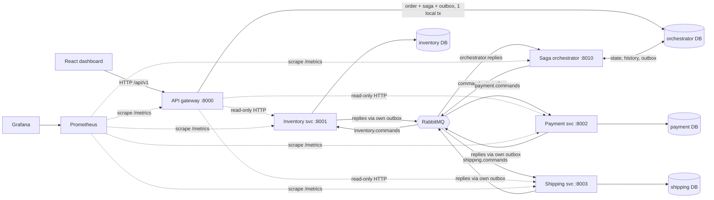

# Architecture

## Communication decisions
| Interaction | Mechanism | Why |
|---|---|---|
| Orchestrator → service commands | RabbitMQ (via transactional outbox) | Work must survive a service being down; decouples availability. |
| Service → orchestrator replies | RabbitMQ (via the service's own outbox) | Same reasons; the reply is committed atomically with the business change. |
| Dashboard reads of inventory/payments/shipments | HTTP (gateway → service) | Synchronous queries; no durability needed. |
| Health / metrics | HTTP | Standard operational interface. |
| Orders | Live in the orchestrator database (documented simplification: a separate Order service would add a hop without teaching anything new). |

Each business service owns its database (`inventory`, `payment`, `shipping`; separate PostgreSQL databases). The orchestrator never touches their tables: it only sends commands and reads replies.

## Message flow of one order
1. `POST /orders` — **one local transaction** inserts order, items, saga (`PENDING→RUNNING`), first step, the `inventory.reserve` command (outbox row) and the idempotency record.
2. The outbox relay publishes the command to `inventory.commands` (persistent message, publisher confirms).
3. Inventory handles it in **one local transaction**: dedupe check → conditional stock update → `processed_messages` → reply (outbox).
4. The reply reaches `orchestrator.replies`; the engine advances the state machine and enqueues the next command. Repeat for payment and shipping. On a business failure it enqueues compensations in reverse order.

Queues per logical queue `Q`: `Q` (durable), `Q.retry` (TTL → back to `Q`), `Q.dlq` (dead letters).
