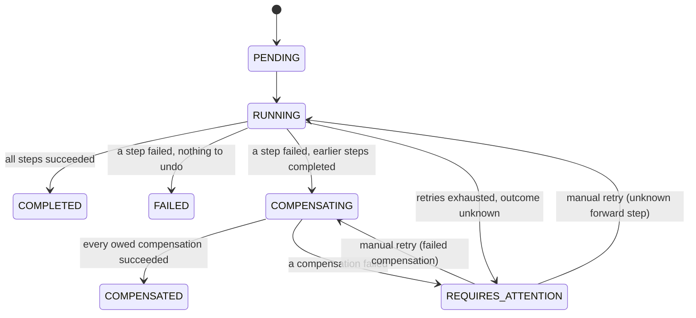

# Saga lifecycle

Terminal: `COMPLETED`, `COMPENSATED`, `FAILED`. Invalid transitions raise `InvalidTransition` (`orchestrator/state_machine.py`).

Steps: `RESERVE_INVENTORY` (undo: release) → `PROCESS_PAYMENT` (undo: void) → `ARRANGE_SHIPPING` (undo: cancel). Step status: `PENDING, DISPATCHED, COMPLETED, FAILED, UNKNOWN`; compensation status: `NONE, PENDING, DISPATCHED, COMPLETED, FAILED, NOT_REQUIRED`.

Rules: only steps whose forward action `COMPLETED` are compensated, in reverse order. A `FAILED` payment is never voided (no effect happened). A step whose outcome is `UNKNOWN` is never compensated blindly. Retryable errors (`TIMEOUT`, …) are retried with exponential backoff (`delay = base · 2^(attempt-1)`, capped) up to `RETRY_MAX_ATTEMPTS`; then the outcome is recorded as `UNKNOWN` and the saga is `REQUIRES_ATTENTION`.

## Compensation vs. rollback
A database rollback erases uncommitted changes as if they never happened, inside one database. A compensating transaction is a *new, committed* business action (e.g. void a payment) that semantically undoes an earlier committed one. Between the two, other parties may have seen the intermediate state (stock was briefly reserved; a payment was briefly authorized). Sagas therefore give *eventual consistency*, **not** ACID isolation across services.
